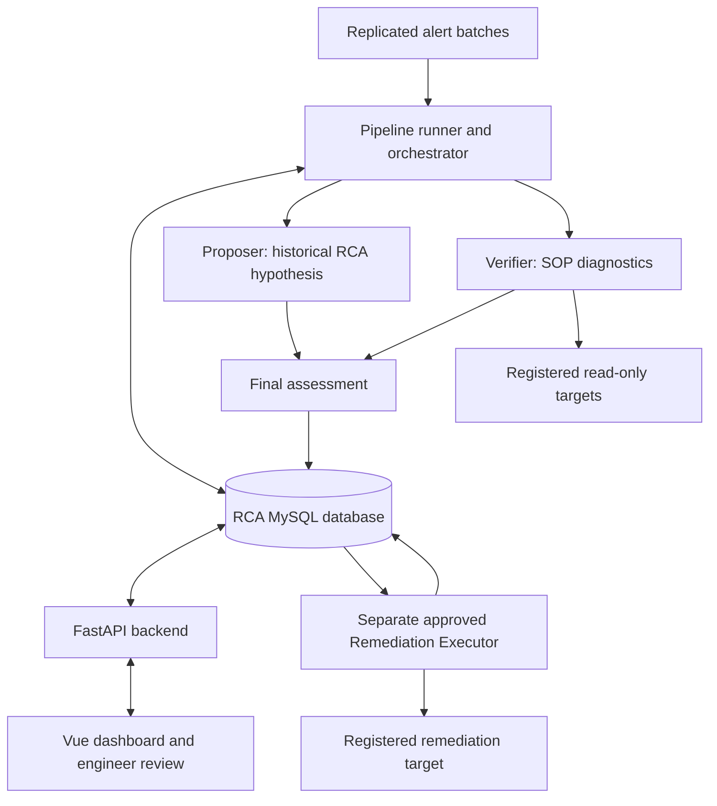

# RCA Agent Dashboard

A Vue 3 and FastAPI application for investigating operational alerts, reviewing
AI-assisted root-cause assessments, onboarding investigation SOPs, and executing
registered remediation actions after engineer approval.

The system combines a batch importer, an orchestrator, a historical RCA Proposer,
an independent diagnostic Verifier, a final assessment step, and a separate
Remediation Executor. MySQL stores the workflow, procedures, evidence, reviews,
target registrations and execution audit records.

**Documentation updated: 30 October 2026.** This README describes the maintained
application workflow. Deployment behavior depends on the matching source files,
database migrations, registered targets and configuration being installed.

## Capabilities

- Incident queue and pipeline board, incident details, analytics and closed reviews.
- Grouped alert messages with their individual source observations retained.
- Historical RCA proposals, structured diagnostic evidence and a combined assessment.
- Engineer acceptance, editing, rejection, closure and knowledge-base promotion.
- SOP editing with revision history and optimistic concurrency protection.
- Administrator onboarding from DAG Python source or reviewed manual input.
- Registered read-only database and SSH targets, encrypted credentials and pinned SSH host keys.
- Approval-required remediation requests with live checks before and after execution.
- Controlled test-case injection when explicitly enabled.

## Architecture



The browser communicates with FastAPI, not directly with MySQL or production
servers. The API records requests and approvals; the separate Executor performs
the registered action. An LLM response is not an executable command definition.

| Component | Responsibility |
| --- | --- |
| `agents/batch_importer.py` | Imports eligible source batches and groups duplicate messages while retaining source row identities. |
| `agents/pipeline_runner.py` | Runs batch import and incident processing in a continuous loop. |
| `agents/orchestrator.py` | Claims work, invokes the agents, persists evidence and manages verification retries. |
| `agents/proposer.py` | Uses curated RCA history to propose a root-cause hypothesis. |
| `agents/verifier_agent.py` | Performs SOP-authorized diagnostics and returns structured findings and Markdown. |
| `agents/final_assessment.py` | Assesses whether the diagnostic evidence supports the historical proposal. |
| `agents/executor.py` and `agents/remediation_executor.py` | Process approved catalog actions and record their execution and verification results. |
| `agents/managed_executor_lock.py` | Coordinates RCA execution per target and validates diagnostic result completeness. |
| `backend/app/` | Provides dashboard, review, SOP, onboarding and remediation APIs. |
| `frontend/src/` | Provides the engineer and administrator interfaces. |

## Incident lifecycle

The normal analysis path is:

```text
NEW -> ANALYZING -> AWAITING_VERIFICATION -> VERIFIED -> CLOSED
```

`ERROR` records a pipeline failure requiring investigation. `CLOSED` follows an
engineer's saved review; it does not mean that a remediation command ran.

1. The importer creates an incident for an eligible site/batch and retains its source observations.
2. The Proposer produces a historical hypothesis.
3. The Verifier independently investigates using the component's SOP and actual tool results.
4. The final assessment compares the hypothesis with the diagnostic findings.
5. An engineer reviews the evidence, records the confirmed RCA and actions actually taken, and closes the incident.

An eligible batch with newly arriving detail rows can be refreshed for analysis;
previous evidence is retained, subject to the installed importer's refresh policy
and existing review/remediation state checks.

`VERIFIED` means the diagnostic/assessment workflow completed. It is not a synonym
for healthy or recovered. Verifier classifications include:

- `NO_REMEDIATION_REQUIRED`
- `MANUAL_REVIEW_REQUIRED`
- `REMEDIATION_RECOMMENDED`
- `FALSE_ALARM`
- `INCONCLUSIVE`

Model transport failures can schedule bounded retries in
`incident_verification_retries`, with completed diagnostic history checkpointed.
An evidence-based `INCONCLUSIVE` report is a completed diagnostic outcome, not
automatically a model-service failure.

## SOP onboarding

Administrators can paste a DAG, select an existing target or register a new one,
and generate a draft for review. Draft generation and activation are separate.

The source-analysis path parses Python without executing the pasted DAG. It
traces supported checks, variable dependencies, calculations and alert branches.
It distinguishes constants already present in the source, deployed configuration
that an administrator must supply, and values calculated from diagnostic results.

Supported analysis includes common string construction and SQL parameter bindings,
relative-date expressions, dependent results, filtering, lookups and aggregate
calculations. Unsupported expressions remain explicit gaps. Source values are
not guessed to make a command executable.

Target IDs, display names and credential names can be suggested from source
connection identifiers and entered target details. Administrators can edit those
names; a connection ID alone does not establish the actual host or database.

The available operating choices are:

- **Investigate only:** register the reviewed diagnostic SOP and target mapping.
- **Investigate with approved execution:** register or link a reviewed action in
  `remediation_action_catalog`, with its exact command and health checks.

Execution-mode onboarding can suggest supported source operations, including
process actions. An optional pasted restart DAG can supply its startup command
and supported Airflow Variable templates. This extracts a command for review;
it does not trigger Airflow or run the pasted source. Missing paths, values or
unsupported operations still require administrator input.

Coverage warnings can be accepted with a recorded reason when the gap is eligible
for acknowledgement. Acceptance does not resolve missing executable text, grant
additional permissions or establish health. An accepted limited-coverage SOP
retains its stated `INCONCLUSIVE` limitation.

Activation validates the reviewed bundle and saves the applicable SOP, DAG,
target/credential registrations, action and audit records in a transaction.
Activation itself does not execute remediation.

## Diagnostic and execution boundaries

The Verifier uses registered tools such as `query_database`, `run_ssh_command`,
`check_http_endpoint` and reachability checks. Exact commands, queries, target
selection, order and conditions come from the reviewed SOP.

- Leading unconditional checks in recognized SOP formats run directly. Conditional
  and optional checks retain their conditions and use the agent's decision loop.
- Premature final answers or empty tool selections receive bounded corrections
  within the attempt. Persistent selection failure produces an explicit missing-
  diagnostic finding rather than repeatedly scheduling the identical failure.
- Missing, failed or truncated evidence must not be treated as a healthy result.
- Current-state checks assess conditions at verification time. They do not prove
  an earlier alert's cause or recovery time unless the SOP includes suitable evidence.
- A current healthy observation, a supported historical RCA, and complete coverage
  of all incident groups are different conclusions.

For remediation, the Executor uses the catalog's `execution_spec`, not command
text extracted from the incident report. Updating an investigation SOP does not
automatically update the action's prechecks or postchecks.

An action must be ACTIVE, match the incident/component/target and approved version,
and have an explicitly approved request. The Executor then:

1. Acquires the applicable work/target ownership and resolves its execution credential.
2. Runs the registered live prechecks.
3. Skips execution if already healthy; stops if the result is inconclusive.
4. Revalidates the incident evidence and executes the registered command when eligible.
5. Runs postchecks and records the outcome and captured output.

Command exit codes and output patterns are interpreted according to each check's
definition. A configured unhealthy exit can establish an unhealthy condition with
empty stdout when no unhealthy output pattern is required. Empty output must not
override that explicit exit contract. Timeouts, truncated evidence and required
pattern mismatches remain inconclusive.

An uncertain outcome after a command may have started requires manual review;
it must not be treated as permission for an automatic replay. Human review and
knowledge-base promotion never execute infrastructure commands.

## Repository layout

```text
agents/                   Pipeline, models, diagnostics, registry and Executor
backend/app/              FastAPI application and onboarding services
backend/tests/            Backend tests
backend/gui_schema.sql    Additive dashboard review and SOP-revision schema
frontend/src/             Vue application
frontend/package-lock.json
README.md
```

Runtime modules such as `source_dependencies.py`, `managed_actions.py`,
`target_name_suggestions.py` and `agents/managed_executor_lock.py` must be deployed
alongside the files that import them. Installer bundles and timestamped backup
folders are not required to run an already updated application.

## Prerequisites and database

- Python and dependencies compatible with the deployed environment. The existing
  deployment uses Python 3.9; retain compatible annotations and package versions.
- Node.js compatible with the committed Vite version. Vite 7 requires Node.js
  20.19+ or 22.12+; see the [Vite 7 guide](https://v7.vite.dev/guide/migration).
- MySQL with the complete RCA schema and the expected replicated alert source.
- Reachability to the configured model gateway and any registered diagnostic targets.

The application uses more than the original starter's two tables:

| Area | Principal tables |
| --- | --- |
| Source alerts | `t_batch_master`, `t_batch_detail` |
| Incident workflow | `live_incidents`, `incident_verification_retries`, `incident_evidence_history` |
| Procedures and curated history | `t_sops_master`, `sop_revisions`, `t_rca_master` |
| Engineer review | `incident_reviews` |
| Onboarding and connections | `registered_dags`, `registered_targets`, `registered_database_targets`, `encrypted_credentials`, `onboarding_events` |
| Approved execution | `remediation_action_catalog`, `remediation_requests`, `remediation_events`, `remediation_executor_heartbeats` |

**`backend/gui_schema.sql` is an additive dashboard migration, not a complete
bootstrap for the full system.** Provision the complete compatible schema through
the deployment's migration process. Existing tables created by older migrations
may need column upgrades; `CREATE TABLE IF NOT EXISTS` does not add missing columns.

The old dashboard-only SELECT/UPDATE grants are insufficient for onboarding and
execution. Assign each service the RCA-table permissions required by its actual
queries. Keep production diagnostic credentials separate from RCA database
credentials; database diagnostic targets use reviewed read-only access.

## Configuration

Keep real values outside Git. The application uses three configuration scopes:

| Location | Important settings |
| --- | --- |
| `backend/.env` | `DB_HOST`, `DB_PORT`, `DB_USER`, `DB_PASSWORD`, `DB_NAME`, `CORS_ORIGINS`, `DEV_USER_NAME`, `DEV_USER_ROLE`, `ENABLE_TEST_INJECTION` |
| `agents/.env` | RCA database settings, `LLM_URL`, gateway authorization, credential-encryption settings and pipeline/Executor configuration |
| `frontend/.env` | Public `VITE_API_BASE_URL`; never database passwords or private keys |

The onboarding assistant can reuse model settings from `agents/.env`. Supply
`LLM_AUTHORIZATION` if required by the gateway. Final assessment can use
`FINAL_ASSESSMENT_LLM_URL`; otherwise it falls back to `LLM_URL`.
The endpoint must accept the request and completion format implemented by the
agent clients; changing to another model provider may require adapting that client.

Encrypted target credentials use versioned keys, including
`CREDENTIAL_MASTER_KEY_VERSION` and `CREDENTIAL_MASTER_KEY_V1` (or the corresponding
version). Backend activation and agent credential resolution must have access
to the matching key material. Preserve existing keys when moving a deployment.

Use the polling, lease, timeout and output-limit settings defined by the installed
agent configuration. Shell environment variables can take precedence over `.env`
values. Keep `use_pure=True` on MySQL connector paths in this deployment; the
C-extension connection path previously failed despite successful TCP access.

The example environment files are templates. Review them against the current
source before use; a historical example is not a complete configuration contract.

## Local development on Windows

Run the following from the project root. Create the virtual environment once:

```powershell
python -m venv .venv
.\.venv\Scripts\Activate.ps1
python -m pip install -r backend\requirements.txt -r agents\requirements.txt
```

Create local configuration without overwriting existing files:

```powershell
if (!(Test-Path backend\.env)) { Copy-Item backend\.env.example backend\.env }
if (!(Test-Path frontend\.env)) { Copy-Item frontend\.env.example frontend\.env }
if (!(Test-Path agents\.env)) { New-Item -ItemType File agents\.env }
```

Fill in the required settings before starting services. For a direct development
API connection, use `VITE_API_BASE_URL=http://localhost:8000` and include
`http://localhost:5173` in backend CORS origins.

Open each terminal at the project root. A development session has four processes
when approved execution is enabled:

**Terminal 1 — API**

```powershell
.\.venv\Scripts\Activate.ps1
cd backend
python -m uvicorn app.main:app --reload --reload-dir app --host 127.0.0.1 --port 8000
```

**Terminal 2 — Vue**

```powershell
cd frontend
npm ci
npm run dev
```

**Terminal 3 — pipeline**

```powershell
.\.venv\Scripts\Activate.ps1
cd agents
python -u pipeline_runner.py
```

**Terminal 4 — approved remediation worker**

```powershell
.\.venv\Scripts\Activate.ps1
cd agents
python -u remediation_executor.py
```

Open the dashboard at `http://localhost:5173` and the API documentation at
`http://127.0.0.1:8000/docs`. Start the Executor only in an environment whose
registered actions and credentials are intended for execution.

## Linux deployment

The existing deployment layout uses `/apps/pythonproj/rca_home`, the environment
`/apps/pythonproj/rca_env`, and API port `10000`.

Deploy the reviewed application files and preserve server-specific `.env` files.
Build the frontend on a compatible build machine or on the server. For a build
served from the same origin as FastAPI:

```bash
cd /apps/pythonproj/rca_home/frontend
npm ci
VITE_API_BASE_URL="" npm run build
```

Deploy the complete resulting `frontend/dist` directory. Copying only Vue source
files does not update the production UI. `npm run preview` is not the production
service used by this application.

Run the API from its application directory:

```bash
cd /apps/pythonproj/rca_home/backend
/apps/pythonproj/rca_env/bin/python -m uvicorn app.main:app --host 0.0.0.0 --port 10000
```

Run the pipeline and Executor as separate services or in separate shells:

```bash
cd /apps/pythonproj/rca_home/agents
/apps/pythonproj/rca_env/bin/python -u pipeline_runner.py
```

```bash
cd /apps/pythonproj/rca_home/agents
/apps/pythonproj/rca_env/bin/python -u remediation_executor.py
```

Use the deployment's process supervision and log configuration. Production runs
omit `--reload`; see [FastAPI deployment guidance](https://fastapi.tiangolo.com/deployment/manually/).
Avoid starting another copy when an existing worker is already running.

| Changed files | Service/build to refresh |
| --- | --- |
| `backend/app/` | Restart the FastAPI backend. |
| Proposer, Verifier, final assessment, orchestrator or importer | Restart the pipeline runner. |
| Executor, action loading or `managed_executor_lock.py` | Restart the Remediation Executor. |
| Shared agent configuration, credentials or registry code | Restart every affected agent process. |
| Vue source or frontend environment | Rebuild and deploy `frontend/dist`. |

## API overview

The installed API's `/docs` page is the authoritative route/schema reference.
Principal endpoints include:

| Method | Route | Purpose |
| --- | --- | --- |
| GET | `/api/health` | API/database connectivity; reports orchestrator heartbeat availability. |
| GET | `/api/dashboard/metrics`, `/api/analytics` | Queue counts and operational analytics. |
| GET | `/api/incidents`, `/api/incidents/{id}` | Incident queue and evidence detail. |
| GET | `/api/incidents/by-batch` | Resolve a site and source batch to an incident. |
| POST | `/api/incidents/{id}/reviews` | Record an engineer decision and close an incident. |
| GET / PUT | `/api/sops/{dag_id}` | Read or save a reviewed SOP revision. |
| GET | `/api/sops` | List SOPs. |
| GET | `/api/closed-incidents` | List closed reviews. |
| PUT | `/api/closed-incidents/{review_id}` | Edit a closed review. |
| POST | `/api/closed-incidents/{review_id}/promote` | Promote an engineer-confirmed review to curated knowledge. |
| GET | `/api/admin/onboarding/targets`, `/api/admin/onboarding/actions` | Available target metadata and eligible actions. |
| POST | `/api/admin/onboarding/assistant` | Generate a validated draft. |
| POST | `/api/admin/onboarding/target-name-suggestions` | Suggest editable target and credential labels. |
| POST | `/api/admin/onboarding/activate` | Activate an administrator-reviewed bundle. |
| GET | `/api/remediations/actions`, `/api/remediations` | Action catalog and request records. |
| POST | `/api/incidents/{id}/remediations` | Create an execution request. |
| POST | `/api/remediations/{id}/approve` | Approve a request. |
| POST | `/api/remediations/{id}/reject` | Reject a request. |
| POST | `/api/remediations/{id}/resolve-manual` | Resolve an uncertain request after engineer investigation. |
| GET / POST | `/api/test-cases`, `/api/test-cases/{id}/inject` | Controlled test catalog and injection. |

Some review flows require an allowlisted `user` email query parameter configured
through `RCA_ALLOWED_LINK_EMAILS`. That asserted URL value is attribution, not
proof of the visitor's identity.

## Verification and troubleshooting

Run relevant tests in an isolated environment, using the matching dependencies:

```powershell
cd backend
python -m unittest discover -s tests -v
cd ..
python -m unittest discover -s agents/tests -v
cd frontend
npm ci
npm run build
```

An injected testcase can run real SOP diagnostics. An approved remediation request
can execute a real action. Keep `ENABLE_TEST_INJECTION=false` outside a deliberately
configured test environment. Offline unit tests and a successful build do not
establish live database, SSH or model-gateway availability.

| Symptom | First checks |
| --- | --- |
| `/api/health` returns 503 | Backend database settings, schema access and the pure-Python MySQL connector path. |
| Frontend cannot reach the API | Backend process/listening port, API base URL, CORS or development proxy configuration. |
| Pipeline remains in `ANALYZING` | Pipeline logs, model-gateway response and Proposer timeout/retry settings. A reachable TCP port does not prove a working model response. |
| Incident remains `AWAITING_VERIFICATION` | Retry `failure_count`, `next_attempt_at`, lease and `last_error`, plus the active pipeline process. |
| Final answer without required diagnostics | Confirm the maintained Verifier scheduler is deployed and the pipeline was restarted; inspect SOP format and recorded tool history. |
| Process check unexpectedly inconclusive | Inspect stdout, stderr, exit code, timeout/truncation and the catalog's exit/output contract. Do not globally reinterpret every exit code 1 as a valid outage. |
| `pgrep: only one pattern can be provided` | Keep a pattern containing spaces inside one shell quote pair; use fenced SOP commands without SQL-style doubled quotes. |
| Restart request fails before execution | Inspect its saved precheck result. Editing the SOP does not change the catalog definition. |
| `ModuleNotFoundError` after deployment | Check the working directory and all required runtime modules, including newly added helpers. |
| Python 3.9 cannot evaluate a Pydantic annotation | Use compatible typing such as `Optional[Model]` for evaluated fields. |
| SFTP cannot create a file | Check ownership and directory write permission for the upload account; deploy source, not caches or backup trees. |

## Operational limits and access

- `/api/health` does not prove pipeline progress. The current API reports the
  orchestrator as unknown when no orchestrator heartbeat is available.
- The dashboard shows persisted results and evidence; it does not stream every
  in-progress model thought or diagnostic step live.
- The optional recheck-current-state interface, separate investigation-history
  UI and SOP sample/live testing package were rolled back and are not this baseline.
  They are distinct from retries, evidence snapshots and test-case injection.
- Source analysis supports defined Python/SQL constructions; it is not arbitrary
  DAG execution or proof of excluded helper/script behavior.
- Built-in managed process actions use Linux process identity information. Use
  a reviewed custom action for environments outside those supported assumptions.
- `DEV_USER_NAME` and `DEV_USER_ROLE` are prototype configuration, not company SSO.
  A production identity boundary must validate authenticated identity and roles;
  an allowlisted email in a link is not a substitute.
- Verifier Markdown is parsed and sanitized before display. Credentials stay on
  the service side and are not browser configuration.

## Git and deployment hygiene

Commit the maintained source, tests, dependency manifests/lock files and reviewed
non-secret examples. Keep local `.env` files, historical environment dumps such
as `agents/pastenv.txt`, private keys, virtual environments, `node_modules`, logs,
Python caches, timestamped installer backups and local update bundles out of Git.

Removing an installer directory from the repository does not remove the runtime
changes already applied to `agents/`, `backend/app/` or `frontend/src/`. Preserve
those active modules, especially the required helper files.

Removing a file from the latest branch does not erase earlier commits. Pushing
to the repository stores source history; deployment, schema changes, frontend
builds, environment configuration and service restarts are separate operations.
