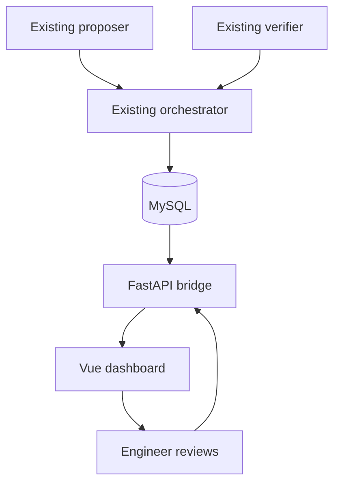

# RCA Agent Dashboard Starter

A Vue 3 dashboard and FastAPI bridge for the current proposer, verifier and
orchestrator. It reads the existing `live_incidents` and `t_sops_master` tables; it
does not modify or replace any of the three agent scripts.

## What is included

- Live pipeline board using the exact orchestrator statuses: `NEW`,
  `ANALYZING`, `AWAITING_VERIFICATION`, `VERIFIED` and `ERROR`.
- Incident page showing the original alert, normalized proposer result,
  historical confidence, SOP and sanitized verifier Markdown.
- Engineer workflow to copy, edit, accept or reject the proposed RCA and add
  the proposed action to a final resolution plan.
- SOP editor with revision history and optimistic concurrency protection.
- FastAPI endpoints using parameterized MySQL statements.
- Generic `.env.example` files with no real credentials.
- No remediation-execution endpoint.

## Architecture



The browser never connects directly to MySQL. It contains only the API base
URL; database credentials remain in the backend environment.

## Existing columns expected

The API reads these existing fields:

```text
live_incidents.incident_id
live_incidents.source_system
live_incidents.component_id
live_incidents.exception_type
live_incidents.error_message
live_incidents.pipeline_status
live_incidents.ai_proposed_root_cause
live_incidents.ai_proposed_fix
live_incidents.ai_verifier_result
t_sops_master.DAG_id
t_sops_master.investigation_sop
```

The current proposer returns JSON, while the current orchestrator stores that
JSON string in `ai_proposed_root_cause`. The API normalizes it for display; no
agent change is required.

## 1. Prepare MySQL

Back up the prototype database and review the additive migration before running:

```bash
mysql -u YOUR_USER -p YOUR_DATABASE < backend/gui_schema.sql
```

The migration creates `incident_reviews` and `sop_revisions`. It does not alter
the agent-owned columns. Give the dashboard account only the privileges it
needs:

- `SELECT` on `live_incidents`
- `SELECT`, `UPDATE` on `t_sops_master`
- `SELECT`, `INSERT` on `incident_reviews` and `sop_revisions`

## 2. Start FastAPI

```bash
cd backend
python -m venv .venv
source .venv/bin/activate
pip install -r requirements.txt
cp .env.example .env
uvicorn app.main:app --reload --port 8000
```

Edit `backend/.env`; the included values are generic placeholders. Interactive
API documentation is available at `http://localhost:8000/docs`.

## 3. Start Vue

Vue recommends a Vite-based setup for new projects, which this starter uses.

```bash
cd frontend
npm install
cp .env.example .env
npm run dev
```

Open `http://localhost:5173`.

## API routes

| Method | Route | Purpose |
| --- | --- | --- |
| `GET` | `/api/health` | API and database connectivity |
| `GET` | `/api/dashboard/metrics` | Status counts and verified rate |
| `GET` | `/api/incidents` | Incident queue, optionally filtered |
| `GET` | `/api/incidents/{id}` | Proposer, verifier and SOP detail |
| `POST` | `/api/incidents/{id}/reviews` | Record a human decision |
| `GET` | `/api/sops` | List SOPs |
| `GET` | `/api/sops/{dag_id}` | Load one SOP |
| `PUT` | `/api/sops/{dag_id}` | Save a reviewed SOP revision |

## Important prototype boundaries

The System Health indicator reports API and database connectivity. It reports
the orchestrator as `unknown` because the current orchestrator does not publish
a heartbeat.

The current verifier returns its evidence only after its three-step ReAct loop
finishes. Therefore this GUI can show status changes and the completed dossier,
but it cannot truthfully stream each tool call live. Live trace streaming would
require the verifier to persist step events or publish them to an event stream.

`DEV_USER_NAME` and `DEV_USER_ROLE` are deliberately simple backend-only
prototype values. Before use beyond a controlled prototype, place FastAPI
behind company SSO and derive the engineer identity and role from validated
identity claims.

Verifier Markdown is parsed and sanitized before rendering. The sanitizer
blocks images, forms, inline event handlers and iframes.
